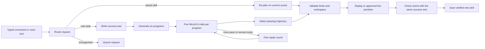

# VARA: a robot arm you can teach

VARA turns a request into a testable skill for an SO-ARM101 arm. It writes the success test first,
compares six candidate programs in MuJoCo, validates the selected trajectory, and uses the same test
to decide whether the result should become a saved skill. A separate PPO experiment learns handoff
reaching in simulation.

The complete local pipeline works with fixture model replies and fake devices. Physical task execution,
real overhead-camera calibration, and live voice/cloud acceptance remain separate gates. See
[HANDOFF.md](HANDOFF.md) and the [verification record](docs/verification-2026-10-17.md) for current status.

## How it works



- **xAI integration:** routing, success specifications, candidate generation, reward generation, and
  the browser voice session. The server exchanges the API key for a short-lived voice token.
- **Daytona integration:** candidate scoring and saved-skill planning in sandboxes; a separate track
  supports four parallel RL jobs. The implemented limits are seven scoring/planning sandboxes plus
  four RL sandboxes. These are capacity limits, not measured cloud usage.
- **Local fallback:** programs run in restricted child processes with a minimal environment. AI-written
  code is never imported into the orchestrator or given the physical driver. Local child processes
  are not equivalent to OS-level cloud sandbox isolation.
- **Motion:** trajectories are data, validated before replay. STOP freezes with torque retained;
  torque off is a separate maintenance action. The optional RL controller remains disabled until
  physical deployment checks pass.

## Measured results

These results are from this laptop; fixture-backed results do not measure live model latency.

| Check | Observed result | Scope |
| --- | --- | --- |
| Five clear-table learns | All executed and saved; 8.6, 10.2, 8.9, 9.9, 11.8 s to execution | Local MuJoCo, fixture replies, fake arm/camera; median 9.9 s |
| Candidate discrimination | Candidates 3 and 4 passed 5/5 trials; four other strategies were rejected | Six clear-table fixtures, seed 7, unchanged obstacle checks |
| Repair recovery | 0/6 initial programs passed; 6/6 repairs passed and a skill was saved | Genuine local scoring with a deliberately failing first generation |
| Starter skills | Both 5/5, zero collisions, limit hits or IK failures | Juice box, seed 7 |
| Two-object routine | 5/5 successful simulated handoffs | Pill bottle followed by juice box, seed 7 |
| Selected PPO policy | 97/100 successes, zero falls | Independent simulation evaluation, seed 0 |

The PPO artifact is the **hand-written-reward baseline**, trained for 507,904 steps. It is not a
model-generated reward winner. Its original evaluation used seed 10001 and reported 94/100;
[policy provenance](rl/policies/handoff_best.json) distinguishes those measurements. The H.264
simulation clip plays in Edge and can be regenerated below.

Local evidence lives under `runs/verification/c7-bench-20261017-194847/`,
`runs/verification/c7-repair-20261017-195100/`, and
`runs/verification/scene-visibility-20261017/carry-guards/`. Run artifacts are gitignored; the
[verification record](docs/verification-2026-10-17.md) explains how the results were obtained.

## Setup

Use Python 3.12. The configured Windows laptop already has `.venv`; use its interpreter directly.
Its environment has no pip module, so install packages through uv:

```powershell
# Existing demo laptop; uv is installed here.
& "$env:USERPROFILE\.local\bin\uv.exe" pip install --python .venv/Scripts/python.exe -r requirements.txt
.\.venv\Scripts\python.exe -m pytest -q
.\.venv\Scripts\python.exe -m ruff check .
```

The last full run on this laptop (2026-10-18) gave 2,222 passed, no skips, in about six minutes;
`scripts/verify.py` runs the same gate plus the fake end-to-end run and Ruff and saves a record.

For a fresh Windows checkout with uv available, create the environment first with
`uv venv --python 3.12 .venv`. For Linux/macOS:

```bash
python3.12 -m venv .venv
source .venv/bin/activate
python -m pip install -r requirements.txt
python -m pytest -q
```

Copy [.env.example](.env.example) to `.env` if it does not exist. Add `XAI_API_KEY` and
`DAYTONA_API_KEY` locally when testing those services; select models available to the account through
`ROUTER_MODEL` and `CODEGEN_MODEL`. Keep `.env` private. `FAKE=1` requires neither service key.
For physical LeRobot setup, follow [hardware calibration](docs/hardware-calibration.md), including
its Windows version/import notes in [CLAUDE.md](CLAUDE.md).

Run `.\.venv\Scripts\python.exe scripts/check_setup.py` for a local dependency/configuration report.
It opens no devices or network connections and reports keys only as configured/not configured.
[Setup inspection](docs/setup.md) explains its exit codes and why it cannot certify physical readiness.

## Run without devices or service calls

```powershell
.\.venv\Scripts\python.exe scripts/e2e_fake.py "clear the table"
.\.venv\Scripts\python.exe -m pytest -q tests/test_repair_integration.py
```

The end-to-end script forces all fakes, runs the actual MuJoCo scorer, validates and replays the winner
on the fake arm, verifies against the simulated final scene, and saves into a copied library under
`runs/e2e_fake/`. It preserves the normal skill library.

For the interactive dashboard, use an isolated demo library:

```powershell
$env:FAKE = "1"
$env:DEMO_MODE = "1"
$demoRoot = Join-Path (Get-Location) ("runs/demo-" + (Get-Date -Format "yyyyMMdd-HHmmss"))
$env:VARA_RUNS_DIR = Join-Path $demoRoot "runs"
$env:VARA_SKILLS_DIR = Join-Path $demoRoot "skills"
New-Item -ItemType Directory -Path $env:VARA_SKILLS_DIR | Out-Null
Copy-Item -LiteralPath skills/_starter -Destination $env:VARA_SKILLS_DIR -Recurse
.\.venv\Scripts\python.exe -m agents.orchestrator --port 8000
```

Open [the dashboard](http://localhost:8000). The voice page is at `/voice`; fake mode supplies a
placeholder token and cannot demonstrate a live voice conversation. Use the typed box for the offline
presentation. [The demo guide](docs/demo.md) includes the reset and narration.

To repeat the five-run benchmark with the isolated paths above, stop the dashboard, then run
`.\.venv\Scripts\python.exe -m agents.orchestrator --bench-demo --runs 5`.
The benchmark resets its configured skill library between runs.

## RL simulation

```powershell
& "$env:USERPROFILE\.local\bin\uv.exe" pip install --python .venv/Scripts/python.exe torch --index-url https://download.pytorch.org/whl/cpu
& "$env:USERPROFILE\.local\bin\uv.exe" pip install --python .venv/Scripts/python.exe -r requirements-rl.txt
.\.venv\Scripts\python.exe -m rl.evaluate --policy rl/policies/handoff_best.zip --episodes 100
.\.venv\Scripts\python.exe -m rl.render_video --policy rl/policies/handoff_best.zip --out web/static/rl_sim.mp4 --seconds 10
```

Linux/macOS users can install the same requirements with their activated environment's pip.
`web/static/rl_sim.mp4` (H.264) and `web/static/rl/curves.json` are tracked so a fresh clone's dashboard
shows the video and the curves; regenerate the video with the command above. Keep `config/rl.yaml` at
`use_policy: false` until the real-arm acceptance in D7/M4 passes.

Reward search (D3 to D5): `python -m rl.rewards.write_rewards`, then `python -m rl.train_parallel
--build-snapshot --verify-snapshot` once per Daytona account, then `python -m rl.train_parallel` (or
`--local`) with `--include-run rl/runs/baseline` to compare against the baseline without retraining it, and
`--no-copy` to compare without replacing `rl/policies/handoff_best.zip`. The module docstring documents the
whole chain. `python -m rl.policy_runner --fake --stage slow --tracker` rehearses D7's staged bring-up and
writes an M4 trial record under `runs/rl/`.

## Hardware status

The assembled SO-ARM101 Pro kit has follower COM8 at 12 V and leader COM7 at 5 V. Read-only inspection
found all six motors on each arm. The follower encoder calibration matches its saved file; the leader's
hardware calibration differs from its saved file and must be reconciled before teleoperation.
Physical joint-to-model signs/offsets still need A6's five measured poses.

The latest camera check on 2026-10-17 opened configured camera 2 and wrist camera 1 at 640x480:
148 frames each over five seconds, with no failed or late frames. This supersedes the earlier camera-2
open failure; camera 0 was previously identified as the laptop webcam. Current captures show a low
table-level view from camera 2 and a mostly dark/occluded wrist view, with no markers detected in either.
Mount and measure the overhead camera, clear the wrist view, and complete the 30-minute camera soak.
The longer attempt subsequently recorded late frames and was stopped early. An independent-reader
diagnostic localized irregular timing to camera 2; B1 remains open pending a stable setup and full soak.
The checked-in homography is synthetic; physical table calibration and STOP checks remain required
before Cartesian replay. See the [verification record](docs/verification-2026-10-17.md) for evidence.

The local print artifact `runs/setup/markers/markers-a4.pdf` contains 13 markers on two A4 pages.
Print at actual size and measure the marker edges; see [the physical setup notes](docs/demo.md#physical-setup-still-to-complete).

Capture an inspection report without motor writes:

```powershell
.\.venv\Scripts\python.exe -m arm.inspect_hardware --follower-port COM8 --leader-port COM7 --out runs/hardware/check-01.json
```

Use a new output filename. See [safety rules](docs/safety.md) and
[hardware calibration](docs/hardware-calibration.md) before any motion command. Clear-table candidates
currently release props from 15 cm into the tray; that maneuver has simulation evidence only.

## Physical setup and tools

**What is still physical:** the arm mapping (A6), grip (A11), Esc drill (A13), camera mount and table
calibration (B3 to B6), the camera soak (B1), the first real learn (I3) and every keyed service gate.
[docs/runbook.md](docs/runbook.md) is the one ordered procedure from tonight's state to the judging table;
[docs/arm-guide.md](docs/arm-guide.md) walks through calibrating and running the arm in plain language;
`tests/test_docs_runbook.py` keeps the commands in both valid. Every tool below writes timestamped evidence under
`runs/` (`VARA_RUNS_DIR` moves it) and never overwrites it. Commands that move the arm take `--real`, ask
you to type that the arm is clear, count down 3 s and freeze the arm on Esc.

- **Arm calibration aids:** `python -m arm.driver --real --jog-joint NAME --deg 20 --hold 10` (A6 sign test),
  `python -m arm.check_mapping --solve runs/calibration/solve.json` (offsets and limits from one reference
  pose), `python -m arm.driver --real --measure-grip` (A11, prints the lines to paste) and
  `python -m arm.driver --esc-latency-report` (A13 verdict over every Esc record). The jog and the grip
  session refuse a start pose outside the commandable band.
- **Camera and table:** `python -m vision.cameras --list` (which index is which), `--check 1800
  [--criterion strict|tracking]` and `--diagnose 60` (B1); `scripts/capture_table.py --expect-all`
  (B3/B4 visibility) and `--check-point X Y` (B5 check spots); `python -m vision.lens` (B5 lens fallback);
  `python -m vision.scene --accuracy LAYOUT.json` (B6) and `--out FILE` (a scene file for `--scene-file`);
  `python -m vision.verify --before --after --spec FILE` (B7).
- **Arm meets camera:** `scripts/touch_markers.py --real --loose` (I2, on the spare cards 13 to 17),
  `python -m arm.replay --real --traj FILE --tracker --record NAME` (A9/A12 tallies) and
  `python -m arm.real_robot --real --carry-test --tracker` (A10).
- **Rehearsal and backup:** `scripts/rehearsal_report.py` (A15 candidate table and cereal-box verdict),
  `python -m agents.library --save-backup NAME --note TEXT [--keep-real]` (stage backup with provenance),
  `python -m agents.orchestrator --bench-run "hand me my pills"` (C8).
- **Live gates:** `scripts/live_gates.py --dry-run`, then without `--dry-run` (C1, C2, C3, C5, C6, C8 and
  the voice token; see [live gates](docs/live-gates.md)); `python -m agents.sandbox_pool --list` and
  `--cleanup` for stragglers; `python -m agents.candidates --eval TEXT --skills none` (C3).
- **Verification and story:** `scripts/verify.py` (I1 record per laptop under `runs/verify/`),
  `scripts/story_numbers.py --markdown` (D8 numbers with their source files) and the gate ledger in
  [docs/gates.md](docs/gates.md).

**Sponsor challenges:** the [Devpost draft](docs/devpost-draft.md) names Best Use of Daytona and Make It
Legendary with the evidence each needs. Neither has its evidence yet: no keyed Daytona or xAI run has been
made, and no Cursor screenshots exist in the repository.

## Project guide

[Contracts](docs/interfaces.md) define the shared data and APIs. [CLAUDE.md](CLAUDE.md) records the
engineering rules; [lane tasks](docs/tasks/) separate software acceptance from physical and service
checks. The [pitch](docs/pitch.md), [demo](docs/demo.md), and [Devpost draft](docs/devpost-draft.md) are
prepared for review and recording; they have not been published.

Claude Code and Codex assisted implementation, tests, and review. Repository history and handoff notes
record the work. Development-tool assistance is separate from the runtime xAI integration.
