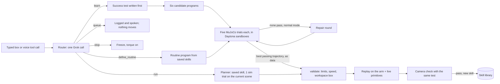

# How VARA works, and why it is built this way

VARA is a tabletop robot arm, an SO-ARM101 (SO-101) follower, that a person with limited mobility can
teach by speaking or typing. A request either runs a skill the arm already knows, becomes a new skill, or
is politely queued. Every new skill gets its success test written before any code exists. Six
AI-written programs then compete in a physics simulation, and only the winner's checked joint path
reaches the real arm. The overhead camera checks the result with the same test before the skill is
saved. A separate reinforcement-learning (RL) track trains the hand-off reach in simulation.

This document explains every feature, the technology behind each one, and the reasons for the main
code decisions. It is a guide, not a contract: the contracts are [interfaces.md](interfaces.md), mirrored
in `schemas/*.json` and `tests/contract/`, and they win wherever this page disagrees with them.

**Sources and date.** Written 2026-10-18 from the code, the config files, the gate ledger
([gates.md](gates.md)), the [implementation brief](implementation-brief.md), [HANDOFF.md](../HANDOFF.md)
and the git history. Where these disagree, current numbers come from `config/`, and current status comes
from `gates.md`. The README and the Devpost draft were written before the keyed Daytona and xAI checks
and before the props changed, so this page supersedes them on those two points.

**Three labels used throughout.** *Sim* means MuJoCo on the laptop. *Fake* means the fixture model
replies, the in-memory arm or the synthetic cameras (`FAKE=1`). *Real* means the physical arm, cameras or
live cloud services. A number without its label is not quoted here.

## Contents

1. [The idea](#1-the-idea)
2. [How a request flows](#2-how-a-request-flows)
3. [Features](#3-features)
4. [Tech stack and why](#4-tech-stack-and-why)
5. [Code decisions and their reasons](#5-code-decisions-and-their-reasons)
6. [Safety model](#6-safety-model)
7. [Status on 2026-10-18](#7-status-on-2026-10-18)
8. [Known limits and open decisions](#8-known-limits-and-open-decisions)
9. [Where things live](#9-where-things-live)

## 1. The idea

Help at home depends on the person: their objects, their table, their habits. A fixed list of robot
functions can't cover that, and a robot that improvises motion from a language model's guess isn't safe
next to someone's hand. VARA takes a middle path built on four ideas.

1. **Requests become testable skills.** VARA writes down what success looks like ("the juice box ends
   inside the tray") in a small predicate language before any program exists. The test, not the program,
   decides whether the task worked: in every simulated trial, and again on the real table through the
   camera.
2. **Generate many, keep the one that passes.** Six programs written with six different strategies are
   each scored over five randomized simulated trials. Collisions, joint-limit hits and errors disqualify
   a program even if the object ends in the right place.
3. **The real arm only replays data.** AI-written code never runs on the laptop and never touches the arm.
   It runs in a sandbox, which hands back a list of joint angles. VARA's own code checks that list
   against joint limits, speed limits and a workspace box, then streams it to the motors.
4. **Saved skills are reused.** A learned skill is stored as its program plus its test. Running it again
   re-plans it in simulation on the current scene (objects move between runs), which takes about a
   second, instead of generating six new programs.

The vocabulary is deliberately small: move known objects between known places, leave obstacles alone,
hand an object to a resting hand. Anything whose success can't be written in the predicates (cloth,
liquids, unknown objects, motion toward the face or body) is queued and spoken back, and nothing moves.

## 2. How a request flows

Every step emits an event (`schemas/event.json`) that the dashboard shows live and that lands in
`runs/<task_id>/events.jsonl`. A learn passes through these stages:

`routing` → `spec_ready` → `writing_code` (×6, plus `candidate_rejected` for any rejected program) →
`simulating` → `candidate_scored` (×6) → `selected` → `validating` → `executing` → `verifying` →
`saved` or `not_saved` → `done`.

A saved-skill run is `routing` → `planning` → `validating` → `executing` → `verifying` → `done`. A queued
request is `routing` → `queued` → `done`. `stopped` and `error` can end any task.

Each task leaves a complete folder, `runs/<task_id>/`: the command, the router reply, the spec, the
before-scene, every prompt and raw model reply, every candidate and its problems, each runner's outputs,
the scores, the selected trajectory, the replay result, the before and after snapshots, the verification
verdict, one wrist-camera still per grasp, the event log and the model token log. Section 5.12 explains
why.

## 3. Features

### 3.1 Talking to the arm: typed box and voice

- **Typed box** on the dashboard sends `POST /command {"text": ...}`. One task runs at a time; a second
  command gets HTTP 409 "busy".
- **Voice page** (`/voice`, embedded in the dashboard) is push-to-talk: hold T or the on-screen button.
  It talks to the xAI Grok Voice Agent over a WebSocket. Voice "eve", 16-bit PCM audio at 24 kHz both
  ways, and `turn_detection: null`, so nothing is sent until the button is released.
- **Three voice tools** are declared to the voice model: `do_task` (the user's exact words go to
  `POST /command`; it says "On it" at once and speaks the result when the task's end event arrives),
  `stop` (calls `POST /stop`) and `list_skills`. Tool arguments that are not a JSON object return an error
  to the model and never become a command.
- **The API key never reaches the browser.** The page asks the server for a 5-minute client secret
  (`POST /voice/token`), and the browser passes it as the WebSocket subprotocol
  `xai-client-secret.<token>`, because browsers can't set an Authorization header on a WebSocket.
- **Voice is a convenience, not the safety path.** Esc anywhere on the dashboard and the STOP button are
  the safety path (section 6).

### 3.2 Routing a request

`agents/router.py` makes one model call with the request, the saved skills (name, description,
parameters) and the scene's names, and gets back exactly one of five actions, validated against
`schemas/router.json`:

| Action | Example | What happens |
| --- | --- | --- |
| `run` | "hand me my pills" → `hand_over {object: pill_bottle}` | Plan the saved skill, validate, replay, verify |
| `learn` | "clear the table" → a success spec | Generate, score, select, replay, verify, save |
| `define_routine` | "when I say good morning, hand me my pills, then my juice box" | Build and score a routine, save it under its name |
| `queue` | "fold my laundry" → reason "needs cloth handling" | Log it and say it; nothing moves |
| `stop` | "stop" | Same as `POST /stop`; a short stop phrase never waits for the model |

After the model answers, the router applies its own checks, and any failure becomes `queue` with a plain
reason:

- a `run` that names a missing skill, or an object that isn't on the table or isn't seen right now;
- a `learn` spec with parameters, with `$` placeholders, naming an unknown or unseen object, an unknown
  zone, or an obstacle (the evaluator already pins every obstacle; see 3.3);
- `"*"` (every object) when no object is seen: "I don't see anything on the table.";
- a spec that is already true on the current scene: "That already looks done.";
- a spec the evaluator can't run: "I could not write a success test for that."

**Spoken names.** The scene uses fixed slot names (`pill_bottle`, `juice_box`, `tea_tin`, `cereal_box`).
Each object in `config/objects.yaml` has a `called` list of the words people use, and the router passes
it to the model as `object_details` together with positions. That covers "my pills", the props that
replaced the originals on 2026-10-18 ("the power bank" is the `juice_box` slot, "the box" or "the
bandage box" is `tea_tin`, "the tape measure" is the `cereal_box` obstacle), and speech-recognition
mangling ("T10", "tee tin" → `tea_tin`).

**Free placements.** "Put the box on the right" or "next to the pill bottle" becomes a `near` spec whose
target the prompt computes from `object_details`: right is −y and left is +y (the arm's own left), the
target stays inside the workspace, and it keeps at least 10 cm from every other object.

**Offline insurance.** If the model API is down, rate-limited or out of budget, a keyword router maps
the demo phrases to fixed actions. A programming error (a `ValueError` or `TypeError` from the call) is
not an outage and is raised instead of hidden.

### 3.3 Success tests written first

A task spec (`schemas/task_spec.json`) is a name, an English sentence and a predicate tree:

| Predicate | True when |
| --- | --- |
| `in_zone` | The object's center is within the zone's radius (only `tray` has one) |
| `near` | The object's center is within `tol` of a table point |
| `moved` | The object moved at least `min`, or is no longer seen (the user took it) |
| `not_moved` | Seen before and after, and moved at most `max` |
| `event` | The run's event log holds that event, e.g. `handoff_done` |
| `all`, `any`, `not` | Combinations |

`"*"` means every object seen before the run, never obstacles. `$name` is filled from the skill's
arguments. One rule is always added: **every obstacle must move at most 2 cm**, so a program that knocks
the obstacle aside fails even if the objects land in the tray.

`sim/success.py::evaluate(spec, before, after, args, events)` is the single evaluator. It runs inside
every sandbox trial and again on the laptop after the real run, on the camera's before and after
snapshots. It is VARA's own code, standard library only, and never AI-written. The dashboard shows the
spec as soon as it exists, under the label "written before any code".

Edge cases are decided on purpose: comparisons are inclusive with a 1e-9 tolerance, so float noise
can't decide a boundary case; a NaN coordinate fails every comparison, so a broken number can never make
a spec pass; an object missing after the run fails `in_zone`, `near` and `not_moved` but passes `moved`.

### 3.4 Six candidate programs

`agents/candidates.py` asks the code model for six programs in parallel. Each prompt
(`agents/prompts/write_skill.md`) contains the Robot API and its notes verbatim from the contracts, the
candidate rules with an explicit list of the traps the checker rejects, the spec in English and JSON, the
current scene, the two starter skills as worked examples, and **one strategy hint per candidate**:

1. Nearest object first, default parameters.
2. Farthest object first.
3. Set `transit_z` to the tallest object or obstacle plus 8 cm on every pick and place.
4. Route around obstacles: rise, move out to x = 0.32 m, then sideways.
5. Slow down to 0.08 m/s and use pitch −π/4 for targets beyond 0.30 m.
6. Fill tray slots far side first, and retry a failed grasp once.

A candidate is one Python file defining `run(robot, args)`. Before scoring, `check_source` (3.7) checks
it. A rejected candidate is regenerated once with its problems appended (skipped in demo mode). In demo
mode the task goes ahead as soon as three candidates are valid. Every prompt, raw reply, candidate file
and problem list is saved to the task folder.

The robot a candidate gets is `SimRobot` (`arm/sim_robot.py`), the Robot API from the contracts:
`scene`, `move_to`, `set_roll`, `open_gripper`, `close_gripper`, `home`, and the helpers `pick`,
`place`, `place_in_zone`, `carry_to_hand` and `run_skill`. Nothing in it reaches MuJoCo, files or the
network.

### 3.5 Scoring in simulation

`python -m sim.run_candidate` scores one candidate (or a saved skill with arguments) over five trials:

- **Trial 1** uses the scene exactly as the camera saw it and records the trajectory.
- **Trials 2–5** shift every object by up to ±1 cm and ±10° of yaw, and every obstacle by up to
  ±0.5 cm, from a seeded random generator (`random.Random(f"{seed}:{trial}")`), so all six candidates face
  the same five scenes.
- Each trial records success from the spec, collisions, joint-limit hits (within 1° of a limit), IK
  failures, simulated seconds and any error. A trial ends in an error after 60 simulated seconds, and the
  parent process kills any trial that takes more than 60 s of wall clock.

**Pass rule:** trial 1 succeeds, at least 4 of 5 trials succeed, and all five have zero collisions, zero
limit hits and no errors. **Ranking:** passing candidates first, then more successes, then the shortest
mean simulated time. The dashboard card shows a short reason for every failure, such as "trial 3:
gripper hit cereal_box", "trial 2: spec not satisfied" or "trial 1: timeout".

The runner prints exactly one JSON line (`schemas/score.json`) as the last line of stdout and writes
`traj.json`, `final_scene.json` (trial 1's end state), `trials.json` and `score.json`.

### 3.6 Repair rounds and budgets

If no candidate passes in normal mode, VARA sends the model the three best failures (code, score and
failure reason) with "fix these failures", gets six new programs and scores again. The contract asks for
one round. `VARA_REPAIR_ROUNDS` (0 to 5, default 1) allows more. Each round works from the latest
ranking, and a round that produces nothing valid (a model timeout, say) moves on to the next. A learn
that still has no passing candidate ends as `queued` ("no candidate passed simulation").

Every stage has a time budget:

| Budget | Normal | `DEMO_MODE=1` (judging) |
| --- | --- | --- |
| Routing and spec | 15 s | 10 s |
| Code writing | 45 s | 30 s, proceed with 3 or more valid candidates |
| Simulation | 90 s | 35 s, unfinished candidates fail as "timeout" |
| Repair round | On | Off |
| Command to arm moving | No cap | 75 s hard cap, else `queued` |
| Real execution | 90 s | 90 s |

A stage past its budget ends the task (`queued` while learning, `error` otherwise), and the arm goes
home. Demo mode shows a 75-second countdown on the dashboard.

### 3.7 Where AI-written code runs

AI-written code (candidates, saved skills, routines and reward functions) runs in exactly two kinds of
place:

- **A Daytona sandbox** (`agents/sandbox_pool.py`). At orchestrator start the pool creates seven
  sandboxes in parallel, six for scoring and one for planning, from the snapshot `arm-sim-v1` (Debian slim,
  Python 3.12, `mujoco numpy pyyaml jsonschema`). VARA's code travels as a tarball of `arm/`, `sim/`,
  `schemas/` and `config/`, tracked by its hash and re-uploaded only when it changes. Per task the pool
  uploads the candidate files, the spec, the scene and the saved skills, runs the scorer on all six at
  once, parses each score line as it lands and downloads the trajectory and final scene of the two best
  passing candidates only.
- **A local child process** whose environment holds only `PATH`, `PYTHONPATH` and the few variables
  Windows needs to start Python (`SYSTEMROOT`, `TEMP`, `TMP`). This is the fallback when there is no
  Daytona key, when `FAKE_SANDBOX=1`, or when a sandbox fails twice. Cards scored this way carry a "local"
  label, so nobody mistakes a local run for a sandbox run.

Around the code there are three layers, described in 5.2: a static source check, a trimmed namespace,
and the process boundary. The cloud sandbox is the strong one. The local child process is weaker
isolation than a Daytona sandbox, and the README says so.

### 3.8 Saved skills, the planner and the library

- **A skill** is `skills/<name>.json` (`schemas/skill.json`): the spec, the program, its simulation
  record (`sim: {successes, trials}`), its real record (`real: {runs, successes}`) and a timestamp.
- **Starter skills.** `hand_over(object)` and `place_in_tray(object)` are hand-written, marked
  `trusted: true`, live in `skills/_starter/` and passed 5 of 5 sim trials. Only trusted skills may be
  planned in a local subprocess while Daytona is available.
- **The planner** (`agents/planner.py`) runs a saved skill once (trial 1 only) on the current scene and
  returns its trajectory and predicted end scene. That is what makes reuse safe: a skill is never a
  recorded motion replayed blindly, it is re-planned for wherever the objects are now.
- **The library** (`agents/library.py`) validates every file, writes atomically (temporary file, fsync,
  rename), refuses names starting with `_`, and refuses a learned skill that would replace a trusted one.
- **Reset demo** archives every learned skill to `runs/archive/<timestamp>/` and restores exactly the two
  starters. **Load backup** copies rehearsal skills from `skills/_backup/` into the library, always as
  untrusted. `python -m agents.library --save-backup` stores a rehearsal skill with a provenance line
  (note, git commit, counts) and resets its real counts unless `--keep-real` says it was learned on the
  physical arm.
- **A failed real check** (`not_saved`) re-plans the next-best passing candidate on the current scene
  once, replays it and verifies again; if that also fails, VARA gives up rather than retrying forever.

### 3.9 Routines

"When I say good morning, hand me my pills, then my juice box" becomes a `define_routine` with two steps.
VARA writes the routine program itself, a `run()` that calls `robot.run_skill(...)` for each step and
stops at the first failure. Its test is `all` of the steps' tests with the arguments filled in. It is
scored, replayed and verified like any learned skill, then saved under `good_morning`, so "good morning"
becomes a `run`. In the sim, `run_skill` loads the saved skill and runs it through the same checker and
restricted namespace, with a depth limit.

### 3.10 Replay on the real arm

`arm/replay.py` is the only way a planned path reaches the motors.

**`validate(traj, limits, fk, box)`** lists every problem; an empty list means accepted. It checks the
schema, that every waypoint is five finite numbers inside the joint limits minus 3°, that consecutive
waypoints differ by at most 2° per joint (60°/s at 30 Hz), that every waypoint's tip lies inside the
workspace box, and that `live` segments name only `carry_to_hand` or `home`.

**`replay(traj)`** then streams the path at 30 Hz:

- **Bridging.** Before each path segment, if the arm is more than 1° from the first waypoint, it moves
  there at no more than 1° per tick (30°/s): a joint-space sweep when the tip stays inside the box,
  otherwise a straight tip line solved with IK. Both are validated before they start.
- **Grip checks.** A close waits until the jaws stop, then compares "holding" with the trajectory's
  `expect_held`. Holding means the reading sits at least the object's `held_min` above the empty-closed
  reading, both measured on the real props. A mismatch rises 5 cm, goes home and returns `grasp_missed`.
- **Every tick checks** the STOP flag, the hand and the box. Outside `carry_to_hand`, a wristband within
  10 cm of the tip freezes the arm (`hand_too_close`) until `/resume`. Within 15 cm of the wristband the
  tip moves at most 0.1 m/s, elsewhere at most 0.2 m/s; a waypoint is split over several ticks to keep to
  that. A tick whose tip would leave the box by more than 1 mm is never sent. The gripper never closes
  within 10 cm of a seen wristband.
- **Failures freeze.** Any exception from the driver, IK or the scene source freezes the arm with torque
  on and returns `error`. A scene source that returns something other than a dict counts as a failure, so
  a broken tracker can't silently switch the hand check off.

### 3.11 The hand-off (`carry_to_hand`)

`arm/real_robot.py` holds VARA's live primitives: `home`, `freeze` and `carry_to_hand`. The hand-off
can't be pre-planned because the hand moves, so it is the one motion computed live, by VARA's own code.

1. **Rise** straight up to a carry height that clears the tallest obstacle or object still on the table
   by a margin, and fits under the 0.30 m ceiling. The whole rise is planned and validated before it
   starts. If there's no room, or the arm doesn't reach the height, it aborts **while still holding** the
   object.
2. **Travel** at that height toward the point 5 cm above the tracked wristband, re-aimed 10 times a
   second as the hand moves.
3. **Track and descend** along a straight line re-aimed at 10 Hz, at no more than 0.1 m/s near the hand.
4. **Release** only when the hand has stayed within 8 cm for 1 s, or on measured arrival. A hand that is
   never seen, or a target outside the workspace, sends the object to the fixed hand-off zone instead.
   Then it backs off 5 cm upward, goes home and logs `handoff_done`.

Deadlines, a stalled clock and tracking limits all keep the grasp rather than open the jaws. The design
rule is that the arm never drops an object onto a hand. When `config/rl.yaml` says `use_policy: true`,
the tracking step uses the RL policy instead of IK (3.14); it is false today.

### 3.12 Seeing the table

- **Cameras** (`vision/cameras.py`). An overhead camera and a wrist camera, both 640×480 at 30 fps in
  MJPG, so two streams fit one USB bus. The overhead camera keeps auto exposure off, because exposure
  changes move marker detections. The wrist camera keeps auto exposure on: with it off, it kept the dark
  exposure it opened with. The wrist camera is for people (live view and one still per grasp), not for
  control.
- **Markers** (`vision/markers.py`). ArUco `DICT_4X4_50`: ids 0–7 are 6 cm table calibration markers,
  10–19 go on top of objects (3 cm), 30–34 on obstacles (4 cm), 40 is the wristband (4 cm), and spare
  cards 13–17 serve the arm-meets-camera check. `scripts/make_markers.py` prints them.
- **Calibration** (`vision/calibrate.py`). A homography from pixels to table meters, fitted with RANSAC
  over the eight tape-measured calibration markers. It is saved only when the mean error is at most 1 cm
  and the maximum at most 1.5 cm. Five or more independent tape-measured check points give the accuracy
  figure that `POST /calibrate` and the dashboard's Check calibration report. A marker on top of an
  object of height `h` looks farther from the point under the lens than it is, so every position is
  corrected with `p = c + (p_table − c)(1 − h/Hc)`, where `c` is the table point under the lens and `Hc`
  the lens height. If the table edges still read more than 1.5 cm off, `vision/lens.py` fits a lens model
  from 15 or more checkerboard photos (refused above 1 px reprojection error), and every tool then
  undistorts frames before detection.
- **Scene state** (`vision/scene.py`). A thread at 10 Hz detects markers, maps ids to objects,
  obstacles and the hand, applies the height correction, reads yaw from the marker's top edge, keeps the
  median of the last five readings, and marks an item `seen: false` after 0.5 s without a detection,
  keeping its last pose. Every published scene validates against `schemas/scene.json`. `snapshot(10)` is
  the median of the next ten frames the camera actually delivers.
- **Verification** (`vision/verify.py`). The before-snapshot is taken when planning starts, so it is the
  scene the sandbox saw. After the arm is home, VARA waits 1 s, takes the after-snapshot, retries for up to
  3 s while a named object is unseen, and runs `evaluate` with the same spec. A dead camera ends the task
  as an error instead of verifying a stale scene.

### 3.13 The dashboard

One page at `http://localhost:8000` (`web/index.html`, `web/static/app.js`):

- the overhead feed with marker overlays and the wrist feed (MJPEG streams);
- the command box and a live timeline from `WS /events`, which replays the last 200 events on connect;
- the success-test banner, labelled "written before any code";
- six candidate cards: strategy hint, a tick or cross per trial, collisions, pass or fail with its
  reason, a LOCAL badge for local scoring, and the winner highlighted;
- the 75-second countdown in demo mode;
- the skill library with real runs and successes, plus Reset demo and Load backup;
- the RL panel: reward-variant learning curves (Chart.js), the simulation video and which carry method is
  live (`ik` or `rl`);
- STOP (and Esc anywhere on the page), Resume and Check calibration;
- a runtime banner from `GET /runtime` that says whether the robot, cameras, model replies and scoring are
  real or fake, so a recording can't pass a fake run off as a real one;
- the voice page in an iframe; the T key is forwarded to it.

### 3.14 The RL track

The hand-off reach is the one motion where a learned controller could beat repeated IK, because the
target moves and hand tracking lags. Lane D trains one in simulation.

- **Environment** (`rl/handoff_env.py`, Gymnasium). The arm alone on `sim/model/arm_only.xml`. The target
  is a point 5 cm above the hand, sampled in x 0.20–0.35 m, y −0.15–0.15 m, z 0.06–0.12 m; in 30% of
  episodes it drifts at up to 5 cm/s.
- **Observation**, 16 numbers: five measured joint angles, the previous action (4), the tip position (3),
  the observed target (3) and the distance (1). The tip comes from forward kinematics of the measured
  joints, never from the simulator's internal state, so the real arm can build the identical vector from
  its encoder readings.
- **Action**: position changes for the four joints that move the tip, each scaled to ±2° per 30 Hz step.
  Wrist roll and gripper stay fixed.
- **Randomized every episode**: joint offsets ±2°, action delay 0–2 steps, observation noise (1 mm and
  0.5°), actuator gain ±20%, target-observation lag 0.1–0.5 s.
- **Success**: tip within 3 cm of the true target for 10 consecutive steps within 150 steps (5 s). The
  tip dropping below 3 cm ends the episode with a −50 penalty.
- **Baseline**: PPO (Stable-Baselines3, MLP policy, 8 parallel environments) on the hand-written reward
  `−d − 0.01·|a − a_prev|² + 1[d < 0.03]`.
- **Reward search** (`rl/rewards/write_rewards.py`, `rl/train_parallel.py`): one Grok call writes four
  reward variants (exponential distance, progress toward the target, smoothness weighted by distance,
  success bonus with a time penalty). Each passes the same source checker as candidates, and they train
  in four Daytona sandboxes from a separate snapshot `arm-rl-v1` with CPU-only PyTorch. The best by
  success rate, then by steps to success, becomes `rl/policies/handoff_best.zip`, with a provenance file
  recording its hash and evaluation.
- **Video** (`rl/render_video.py`): MuJoCo's offscreen renderer records the chosen policy tracking a
  drifting target, encoded as H.264 for the dashboard.
- **Real deployment** (`rl/policy_runner.py`) is staged: target fixed on a marker, then a slowly moving
  hand, then normal speed, with a per-trial report. It is off (`use_policy: false`) until gate M4 passes:
  4 of 5 real tries within 3 cm, never over the speed limit.

### 3.15 Running without hardware

Four independent flags replace each outside dependency with a fake behind the same function signatures.
`FAKE=1` sets all four.

| Flag | Replaces | Behaviour |
| --- | --- | --- |
| `FAKE_LLM` | xAI | Replies come from `tests/fixtures/llm/`, keyed by phrase; an unknown phrase routes to `queue`; candidate code comes back inside a fenced block so the real code-extraction path runs too |
| `FAKE_SANDBOX` | Daytona | The same scorer command runs as a local child process (also the live fallback) |
| `FAKE_ROBOT` | The arm | An in-memory arm that follows commands instantly; grip checks return `expect_held` |
| `FAKE_CAMERA` | Cameras | A synthetic camera renders real ArUco markers from `config/fake_scene.json`, with height parallax; the after-snapshot is the sandbox's predicted end scene |

`python scripts/e2e_fake.py "put the juice box in the tray"` runs the whole pipeline offline, with real
MuJoCo scoring, and passes only if it ends in `saved`. It uses a copied skill library so the real one is
never touched.

### 3.16 Operator tools and evidence

The physical bring-up is a sequence of measured gates (see [runbook.md](runbook.md)), and nearly every
measurement has a tool. Each tool writes timestamped evidence under `runs/` and never overwrites earlier
evidence.

- **Arm.** `arm.inspect_hardware` (read-only motor and calibration report), `arm.driver --jog-joint`
  (single-joint sign test), `arm.check_mapping --solve` (joint offsets and limits from a reference pose),
  `arm.driver --measure-grip` (gripper range and per-object `held_min`), `arm.driver --esc-latency-report`
  (the STOP latency verdict), `arm.replay --record` and `arm.real_robot --carry-test` (tallies of real
  replays and hand-offs).
- **Camera and table.** `vision.cameras --check/--diagnose/--list`, `scripts/capture_table.py` (marker
  visibility and check points), `vision.lens`, `vision.scene --accuracy` and `--out`, `vision.verify`.
- **Arm meets camera.** `scripts/touch_markers.py --real --loose` hovers over five loose cards so the
  operator can measure the gap with a ruler.
- **Cloud and models.** `scripts/live_gates.py` runs every keyed check in order (model ping, router,
  candidates, Daytona smoke test, pool bench, saved-skill bench, voice token), with a sandbox inventory
  before and after each Daytona step. `agents.sandbox_pool --list/--cleanup` finds and deletes stragglers.
- **Story.** `scripts/verify.py` (the full test gate plus a record per laptop), `scripts/story_numbers.py`
  (every number for the Devpost page, with the file it came from), `scripts/rehearsal_report.py`, and the
  gate ledger [gates.md](gates.md).

## 4. Tech stack and why

| Layer | Choice | Why |
| --- | --- | --- |
| Arm | SO-ARM101 Pro kit: a leader and a follower with STS3215 encoder servos | Low-cost 6-DoF arm with an official MuJoCo model and LeRobot support; the leader arm allows teleoperation for calibration and measurement |
| Arm I/O | LeRobot 0.6.2 (Seeed fork, `lerobot.robots.so_follower`), wrapped in one module | It already speaks the servo protocol and handles calibration files. Its defaults are unsafe on our arm (5.5), so one module, `arm/driver.py`, owns it |
| Simulation | MuJoCo 3.16 with TheRobotStudio's SO-101 MJCF | The upstream model matches our arm; MuJoCo gives contact reports for collision scoring, fast position-controlled stepping (one place-in-tray is about 11 s simulated in 0.5 s of wall clock), an offscreen renderer for video, and one model shared by IK, scoring and RL |
| Language | Python 3.12 with type hints | LeRobot, MuJoCo, OpenCV, Stable-Baselines3 and both cloud SDKs are Python-first, so one language covers every lane |
| Server | FastAPI with uvicorn | Plain HTTP endpoints, a WebSocket for events and streaming MJPEG responses in one small app; `TestClient` drives the whole pipeline in tests |
| Concurrency | Threads, not asyncio, for blocking work | Serial I/O, subprocesses and MuJoCo all block. Each task gets a worker thread and each stage a helper thread the worker watches, so STOP can abandon any stage at once |
| Contracts | JSON Schema (`jsonschema`, Draft 2020-12) plus contract tests | Four lanes and several AI coding sessions worked in parallel. Every JSON that crosses a process or network boundary is validated against one shared schema |
| Config | YAML (PyYAML) and `python-dotenv` | Measured values (joint map, limits, objects, scene) are hand-edited with comments recording when and how each was measured; keys stay in a gitignored `.env` |
| Models | xAI Grok through the `openai` SDK (`base_url=https://api.x.ai/v1`) | xAI's API is OpenAI-compatible, so one well-known client covers it. A fast model routes (default `grok-4.3`, no reasoning, temperature 0.2) and a stronger one writes code (default `grok-4.7`, low reasoning, temperature 0.7). Both are overridable in `.env`. xAI is also a sponsor track |
| Voice | Grok Voice Agent realtime API over a browser WebSocket | Speech in, speech out and function calls in one connection; ephemeral client secrets keep the key on the server; `httpx` mints the token |
| Sandboxes | Daytona (Python SDK 0.225) | Real isolation for untrusted generated code, fast parallel creation from a prebuilt snapshot, file upload and process exec. A sponsor track ("Best Use of Daytona") |
| Vision | OpenCV 4.13 headless with ArUco | ArUco is in the main package from 4.7, so no contrib build is needed. The headless build matches what LeRobot installs, and exactly one OpenCV package is allowed, because two side by side break `cv2` |
| Markers vs. learned detection | Printed ArUco fiducials | Millimeter-level, id-labelled poses with yaw from a cheap webcam, no training data. The documented fallback without a printer (color tape) loses yaw and accuracy |
| RL | Gymnasium + Stable-Baselines3 PPO, CPU PyTorch | Standard, well-tested PPO for a small MLP. The laptop has no NVIDIA GPU, and GPU sandboxes don't speed up a policy this small, so the RL snapshot installs the CPU wheel, which avoids a multi-gigabyte CUDA download |
| Video | PyAV (H.264, yuv420p) | OpenCV's default mp4v output played in OpenCV but not in Edge, the demo browser |
| Front end | Plain HTML and JavaScript, no build step; Chart.js 4.4.1 from cdnjs with a pinned version and an SRI hash | Nothing to compile on the demo laptop; the orchestrator serves the files directly; the integrity hash means a tampered CDN file doesn't run |
| Tests and lint | pytest and Ruff (line length 110; rules E, F, I, B) | Fast checks with no hardware or network: tests use the fakes, and verifiers ran the suite with network, serial ports and cameras blocked |
| Environment | `uv` for the venv and installs | The demo laptop has no `python3.12` on PATH (the default is 3.14), and uv builds a 3.12 venv directly |
| Development | Claude Code (and Codex, Cursor) with `CLAUDE.md`, path-scoped rules and permissions | The repo is built to be worked on by AI coding sessions safely; see 5.14 |

## 5. Code decisions and their reasons

### 5.1 Architecture and contracts

- **Contracts first, then four lanes.** The team split into lanes: A (arm, simulation, replay, voice
  page), B (vision, dashboard), C (agents, sandboxes, orchestrator) and D (RL, story). Each file has one
  owning lane. The contracts (prose in `interfaces.md`, JSON Schemas, contract tests) were fixed before
  the code, and every module was first built as a working fake behind its final signature (task S0). So
  every lane could build against something real from the first hour, and swap one fake at a time for the
  real thing.
- **Contracts change only by agreement.** Editing `docs/interfaces.md`, `schemas/` or `tests/contract/`
  triggers an approval prompt in Claude Code. When a need arose that the schema didn't allow, the code
  worked around it rather than changing the schema alone. The scene schema has no provenance field and
  forbids extra keys, so the live scene-file writer puts provenance in a sidecar file
  (`scene.json.source.json`), and the real-arm tools refuse a scene file without a live sidecar. Likewise
  the score line is exactly `schemas/score.json`, so the `runner` label ("local" or "daytona") travels in
  a wrapper beside it, never inside it.
- **One unit system.** Meters, radians and seconds everywhere. Joint vectors are always
  `[shoulder_pan, shoulder_lift, elbow_flex, wrist_flex, wrist_roll]`; the gripper is a separate value from
  0.0 (closed) to 1.0 (open). LeRobot's degrees and its 0–100 gripper scale exist only inside
  `arm/driver.py`, which also exports the four helpers that convert the few config values written in
  percent. Unit slips between modules are a classic source of robot accidents; this removes the
  possibility at every module boundary but one.
- **One frame.** The origin is on the table directly below the shoulder-pan axis, +x straight out, +y to
  the arm's left, +z up. The upstream MJCF puts the pan axis at x = 0.0388 m, so the robot body is shifted
  by that amount, and MuJoCo's world frame *is* the contract frame: no conversion anywhere.
- **The sandbox bundle shapes the imports.** The code uploaded to sandboxes is only `arm/`, `sim/`,
  `schemas/` and `config/`. So `arm/` and `sim/` never import `agents/`, `vision/`, `rl/` or `web/`, and
  `check_source` lives in `sim/candidate_check.py` (re-exported by `agents/candidates.py`), because the
  sandbox needs it and has no `agents/`.
- **Small fake helpers, no settings module.** Each module that needs a fake flag reads it with a
  three-line helper, so the sandbox bundle doesn't depend on a shared settings package.

### 5.2 Keeping AI-written code contained

The central rule (CLAUDE.md hard rule 1): AI-written code runs only inside `sim.run_candidate`, in a
Daytona sandbox or the clean local child process. It is never imported, `exec`'d or `eval`'d in the
orchestrator, and it never gets the real arm.

- **The trajectory is data, never code.** What comes back from a sandbox is a JSON list of joint angles
  and grip actions. The laptop validates it and replays it. Even a malicious program can at worst produce
  a path, and the path still has to pass `validate`, the driver's clipping and the per-tick checks.
- **Layer 1: a static source check** (`sim/candidate_check.py`). Only `import math`; top level limited to
  a docstring, imports, functions and literal assignments; the entry function with its exact arity; no
  identifiers starting with `_` (which blocks the usual dunder escapes); none of `open`, `exec`, `eval`,
  `compile`, `getattr`, `type`, `object`, `super`, `mro` and similar; no `class`, `with`, `global`, `async`
  or `yield`; at most 200 lines. It runs in the orchestrator before scoring and again inside the sandbox.
  It is a filter that keeps programs inside the Robot API, not the security boundary.
- **Why `BaseException` is banned everywhere.** The simulated time limit is raised as a
  `BaseException` subclass so ordinary `except Exception` can't swallow it. So the checker rejects a bare
  `except:`, the name `BaseException` anywhere (including aliases), `mro` (because
  `Exception.mro()[1]` is `BaseException`), and `return`, `break`, `continue` or `raise` leaving a
  `finally` block (they discard or replace the in-flight exception). Because some escapes can't be seen
  statically, the runner also treats simulated time past the limit as an error whatever the program
  returned, and once the limit passes every `SimRobot` motion method raises again.
- **Layer 2: a trimmed namespace** (`sim/restricted.py`). The builtins minus the dangerous ones, plus a
  restricted `__import__` that serves `math` and nothing else (without it, a program's own `import math`
  fails), and `print` redirected to stderr so stdout carries only the score line.
- **Layer 3: the process boundary.** All trials run in one spawned child process that the parent kills
  on the wall clock. A second pipe is a dead-man's switch: if the parent dies, the child sees end-of-file
  and exits, so a killed runner leaves no orphan burning CPU. Inputs are parsed as strict JSON (NaN and
  Infinity refused).
- **The program can't grade itself.** Its return value is logged, never scored. Success comes only from
  `evaluate` on the spec, the start scene, the simulator's final scene and the event log.
- **`SimRobot` resists tampering.** Public attributes can't be set or deleted. `reset()` and
  `set_skill()` raise whenever AI code is on the call stack. `stats`, `events`, `scene()` and
  `trajectory()` return fresh copies. Every internal helper starts with `_`, which the checker forbids a
  program to name.
- **Reward functions get the same treatment.** They pass the same checker (entry `reward(obs, action,
  prev_action, info)`) and are loaded inside each training worker through the restricted namespace.
  `rl/train.py` deliberately loads no `.env`, so a reward function can never see an API key, and every
  worker response has a deadline enforced by the parent, so a reward that hangs (even inside native math
  code) is killed.

### 5.3 Simulation choices

- **Reach forced the IK design.** The SO-101's upper arm plus forearm is only 0.251 m. Pointing the jaws
  straight down is impossible far from the base or high up: the tray and the transit height need the
  jaws tilted 30–45° or more from vertical. So `arm.ik.solve` tries the requested pitch first and then
  relaxes it toward horizontal through a ladder of −75°, −60°, −45°, −30°, −15° and 0°, nearest first.
  The solver is damped least squares (λ = 0.02) with a finite-difference Jacobian from
  `mujoco.mj_kinematics`. A planar reach pre-check rejects impossible (target, pitch) pairs before
  iterating and supplies closed-form start postures, so a solve takes well under 2 ms on demo targets and
  under 20 ms even when every rung must be proven unreachable. Some corners of the workspace box are
  unreachable by design, and `move_to` returns False there.
- **A grasp site beside the tip.** The SO-101 jaw is asymmetric: only the moving jaw swings, and the
  closed-jaw midpoint (`tip`) sits 0.3 mm from the fixed finger's inner face, so an object centered on
  `tip` would be inside the finger. Picks target a separate `grasp` site 2.46 cm along the closing
  direction (`solve_grasp`, `fk_grasp`). `move_to` keeps targeting `tip`, as the contract says. The
  gripper opens fully before descending, because at 0.6 rad the moving finger hits the wider objects.
- **Fitted boxes for the gripper's collision shapes.** The upstream gripper uses convex-hull mesh
  collisions, which fill the space between open fingers and push objects out of the grasp. The model
  replaces them with boxes fitted to the mesh vertices: one housing, one thin box per finger
  (`sim/model/fit_gripper.py`).
- **Grasps attach kinematically, with strict tolerances.** Friction grasping in simulation is slow and
  fragile. Instead `close_gripper` attaches the nearest object only when the grasp center is within 1.0 cm
  of its vertical center line, between 20% and 80% of its height and (for boxes) within 20° of its yaw.
  While held, the object's pose is rewritten after every physics substep and it stops colliding with the
  robot (but not with anything else). A released object ignores the robot until it has separated (6 cm or
  1 s), because a tilted gripper lets it slide out along the lower finger, which is a release, not a
  collision. The tolerances are tight on purpose: the risk table's answer to "grasps that pass in sim
  miss on the real arm" is to make the simulation fail what the real arm would miss.
- **Contacts are counted on the physical state after every substep.** At 0.2 m/s a 5 mm tray wall can be
  crossed inside one 33 ms tick, so checking once per tick would miss collisions. The timestep is 1/600 s,
  with 20 substeps per 30 Hz tick. Robot self-contacts count too ("gripper hit upper_arm"), because a
  self-colliding sweep must never reach the real arm.
- **The default move is deliberately naive.** Without `transit_z`, a move to a new spot is one joint-space
  sweep from the current pose, which can pass low over obstacles. Programs that notice the obstacle and
  set a transit height score better. That gives the six-way comparison something real to discriminate.
- **Measured, not assumed.** `ROLL_OFFSET` (−1.529 rad) was measured numerically from the jaw axes; the
  brief's sign in the roll formula was wrong and the code says so. The kit's placeholder home pose put the
  gripper 5 cm above the table inside the tea tin; the new home pose, `[0, −1.35, 0.02, 1.45, 0]`, folds the
  gripper against the base with its tip at (0.11, 0, 0.27) and hides no marker from the overhead camera.
- **The props changed; the code didn't need to.** On 2026-10-18 the props became an empty pill bottle,
  a power bank (in the `juice_box` slot), a small box (`tea_tin`) and a 5.7 cm tape measure standing on
  edge as the obstacle (`cereal_box`). The tray moved to (0.19, 0.17) with a 9 cm radius and three slots.
  Because names are slots and every size lives in `config/objects.yaml`, only the config and the generated
  scene changed. One consequence: the obstacle is now shorter than the objects, so the starter skills
  compute the transit height from the tallest obstacle *or object*. Older docs describing a 20 cm cereal
  box and a 0.28 m transit height describe the previous layout; the reach limit and the pitch ladder are
  the lasting reasons behind them.
- **`place` keeps objects off the table.** When the contract's default release height would press a
  tall object into the table at the release tilt, the release height is raised by the deficit.
  `place_in_zone` skips tray slots whose approach would collide.

### 5.4 Scoring rules

- **The test is written before the code** so it can't be bent to fit a program, and so the same test can
  judge both the simulation and the real table.
- **Six hints instead of six temperatures.** Sampling the same prompt six times tends to produce six
  versions of the same plan. Six explicit strategies (nearest first, farthest first, transit height, route
  around, slow and tilted, far slots first with retry) make the candidates differ by design, which is what
  makes a comparison worth running and worth showing.
- **Shared, seeded perturbations.** Every candidate faces the same five scenes, so the ranking compares
  programs, not luck. The ±1 cm shifts approximate camera error; a program that only works at the exact
  observed pose fails.
- **Trial 1 must pass and collisions are fatal.** Trial 1 is the scene as observed and the one whose
  trajectory gets replayed, so a candidate that fails it can never be selected. Zero collisions and zero
  limit hits across all five trials are required, because a near miss in simulation is a likely hit on
  the real table.
- **Short failure phrases.** Error and collision texts are clipped (a program can raise an exception
  carrying megabytes) and collision phrases name bodies, not geoms ("held juice_box hit tray"), so the
  dashboard cards stay readable.

### 5.5 The arm driver: measured hazards

These come from measurements on our follower ([CLAUDE.md, Arm hazards](../CLAUDE.md#arm-hazards-measured-on-our-so-101)).

- **Goal sync before every torque enable.** Enabling torque drives each STS3215 servo straight to its
  stored `Goal_Position`, and stale goals were measured up to 168° away. LeRobot's `connect()` turns
  torque off and on internally without syncing. So before every torque enable, including the one hidden
  inside LeRobot's `configure()`, the driver writes `Goal_Position = Present_Position` in raw ticks.
- **Disconnect never drops the arm.** LeRobot's default turns torque off on disconnect, which drops the
  arm and anything it holds on exit, Ctrl+C or an exception. The driver sets
  `disable_torque_on_disconnect=False`, and torque goes off only by an explicit maintenance action.
- **After torque off, every write is blocked** until an explicit re-enable that syncs the goals first,
  because writing a goal switches torque back on.
- **The driver clips whatever the caller asks.** Every command is clipped to the calibrated range minus
  3° and to 2° of change per call. LeRobot's `max_relative_target` limits only `send_action` relative to
  the present position, so it is a second layer, not the first. A NaN or infinite target can't be clipped
  (NaN compares false with every bound), so it raises before anything is sent.
- **`get_driver()` returns an unconnected driver.** Connecting powers the arm, so the `--real` tools
  connect only after a human types that the arm is clear. Until then every command raises instead of
  silently doing nothing. The orchestrator's `--real` startup tries the connect up to three times, because
  one dropped status packet during LeRobot's motor setup aborts the whole connect, and a failed connect has
  already left the arm holding.
- **The gripper holds at contact minus 3.** A stalled STS3215 overheats, so after a close the driver holds
  at the measured contact reading minus 3 on the 0–100 scale.
- **Calibration is per arm and per calibration file.** LeRobot's 0° is the midpoint of each joint's
  calibrated range, not the rest pose, so "all joints at 0" is a large swing. The joint map's signs and
  offsets were measured (A6: all five signs match the model; offsets +7.96°, −1.58°, −8.04°, −1.06°,
  +3.47°) and must be redone after any recalibration. The physical ranges reach 7.7–20.7° past the model
  on every joint; `config/limits.yaml` keeps the overlap, so the arm is never commanded where the model
  can't plan. The gripper's "open" is set to 51 on LeRobot's scale (96 mm between the tips, the model's
  full opening) rather than 100, which would open about 5 cm wider than the plans allow for.

### 5.6 Replay and live primitives

- **Replay re-validates.** `replay()` calls `validate` itself and never moves on a non-empty result, even
  if the orchestrator already validated, so no caller can skip it.
- **Speed is limited at the tip, not just at the joints.** A 2° joint step near full extension moves the
  tip much further than near the base. Replay measures tip travel per tick with forward kinematics and
  splits waypoints over several ticks to stay under 0.2 m/s, or 0.1 m/s near the hand.
- **Straight lines when a sweep would leave the box.** A joint-space sweep between a folded and an
  extended pose arcs the tip over the 0.30 m ceiling, so bridges and homing fall back to a straight tip
  line solved with IK, validated before it starts.
- **Continue from the last command, not a sagging reading.** After a fresh connect the arm can sag about
  3 cm at home, just behind the box's near edge. Replay bridges from the driver's last command when there
  is one, and the one bridge out of a sagged start is allowed back into the box only while it moves back
  in. This was one of three fixes the real arm-meets-camera check needed.
- **The hand-off rises first and aborts while holding.** Simulation and the real arm use the same
  rise-travel-descend structure, so the sim's clearance checks predict the real motion. Every failure
  mode keeps the object in the gripper, because an object dropped near a hand is worse than a hand-off
  that didn't happen.

### 5.7 Vision

- **Never-detected items are left out of the scene.** Otherwise the sandbox would place them at the
  origin, inside the arm base, and every candidate would collide with a phantom object.
- **Unseen keeps the last pose.** An item not seen for 0.5 s is marked unseen but keeps its pose, so
  `moved` can recognize "the user took it" and obstacles keep their collision bodies.
- **A dead camera is an error, not an empty table.** When more than half the grabs in a snapshot fail,
  or the tracker publishes nothing for too long, `snapshot` raises instead of returning a scene where
  every item happens to be unseen.
- **The synthetic camera uses f = 450 px, not 600.** At 600 px the brief's own fake camera couldn't see
  its own calibration markers at the table edges. 450 px is a typical 70° webcam and keeps every marker at
  least 29 px inside the frame. The fake camera renders real ArUco images with height parallax, so the
  real detector and the height correction are exercised in every offline test.
- **Raw and undistorted pixels never mix.** Every evidence file records the hash of the lens file its
  frames were undistorted with, and the tools refuse to compare a before and an after taken with
  different lenses.
- **Fake scenes never feed the real arm.** Every `--real` tool that reads a scene file requires the
  writer's live provenance sidecar and a fresh scene; `--tracker` refuses a fake tracker or camera.

### 5.8 Model calls

- **One function, a whole-call budget.** `agents.llm.chat()` takes a timeout for the whole call, retries
  included. 429 and 5xx answers are retried with 1, 2 and 4 s backoff while the budget allows, so the
  orchestrator's stage budgets hold even when the API is slow.
- **Structured output first, text second.** With a schema, the first attempt asks for `json_schema`
  output. Any other 4xx falls back to plain text and parses the first `{...}` block, because not every
  model accepts every schema feature. The result is always validated, and on failure the model is asked
  once more with the validation error appended.
- **Keys never leak.** The key is read only inside the real client factory and is scrubbed from every
  error message. Tests replace the client factory with a stub and never call xAI.
- **Token logs per task.** Every call appends model, purpose, tokens and milliseconds to
  `runs/<task_id>/llm.jsonl`, which is how costs and latencies get measured instead of estimated.

### 5.9 Daytona

- **`auto_stop_interval=0`.** Daytona's idle auto-stop could otherwise shut a sandbox down mid-demo
  between requests, or mid-training.
- **Hard caps: 7 for scoring and planning, 4 for RL.** Sandboxes cost credits. Only three modules create
  them (`agents/sandbox_pool.py`, `rl/train_parallel.py`, `scripts/daytona_smoke.py`). The pool lists the
  account's labelled sandboxes before creating any, so the cap holds across processes whenever that
  listing succeeds.
- **Every sandbox is deleted on shutdown,** from `shutdown()`, `atexit` and SIGINT/SIGTERM handlers, and
  deletion continues even when one delete raises. `--list` and `--cleanup` find stragglers after a crash.
- **Snapshot for dependencies, tarball for code.** The snapshot holds only the slow-to-install packages.
  The code is uploaded as a hash-tracked tarball, so changing VARA's code never requires rebuilding an
  image.
- **Download little.** Only the two best passing candidates' trajectories and final scenes come back
  (the second is the fallback if the first fails its real check), plus every candidate's small per-trial
  file for the dashboard.
- **Failing over is visible.** A sandbox that fails twice is retired and its work runs locally, and each
  score carries `runner: local` or `runner: daytona` all the way to the dashboard card and the evidence
  files.
- **A separate RL snapshot.** `arm-rl-v1` adds Gymnasium, Stable-Baselines3 and CPU PyTorch, keeping the
  scoring image small.

### 5.10 RL

- **The observation uses forward kinematics of measured joints,** never simulator internals. The real
  arm only has encoder readings, so the policy must learn from exactly what the real arm can compute.
- **Domain randomization** (offsets, delay, noise, gain, target lag) targets the specific sim-to-real gaps
  this arm has: calibration error, USB latency, encoder noise, servo strength and the camera's lagging
  hand position.
- **The fall penalty lives in the environment, not the reward formula.** With the formula alone, the
  policy learned to fall: ending an episode early by dropping the tip beat accumulating negative distance.
  Keeping the −50 penalty at the environment level means every Grok-written variant gets it too.
- **The baseline competes with the variants.** `--include-run` adds the already trained baseline to the
  comparison without retraining it. Today the selected policy is that hand-written-reward baseline, not a
  generated reward, and the provenance file says so.
- **The policy stays off on the real arm** until M4 passes. Even when on, it sends actions through the same
  driver and the same per-tick safety session as IK, so the speed caps, the box and STOP still apply.

### 5.11 Orchestrator concurrency

- **One task at a time.** A second command gets 409, so two plans never compete for the arm.
- **Stage threads under a watchful worker.** Each stage runs in a helper thread that the task's worker
  polls every 20 ms for the stop flag and the budget. A stage that hangs (a slow model, a stuck
  subprocess) can't block STOP or overrun its budget.
- **An arm lock** serializes the real-arm section (before-snapshot, validate, replay, home,
  after-snapshot) with `/resume`.
- **Events are validated before they're emitted,** then go to a 200-event buffer (replayed to every new
  WebSocket client, so a page reload loses nothing), to the task's `events.jsonl` and to subscribers.

### 5.12 Evidence and honest numbers

- **Everything a task does is saved** under `runs/<task_id>/`, and every tool writes new timestamped
  evidence instead of overwriting old files. The Devpost numbers come from `scripts/story_numbers.py`,
  which reads those files and prints the source path beside each figure.
- **Fake results are labelled as fake,** in the runtime banner, the LOCAL badges, the evidence files and
  the docs. A backup skill learned with the fake arm has its real counts reset to zero, because the
  orchestrator counts a fake replay as a run.
- **Gates have a ledger.** A gate in the schedule is ticked only after its row in [gates.md](gates.md)
  reads `pass` with a time, a name and an evidence path someone else can open.

### 5.13 Windows specifics

The demo laptop runs Windows 11, so several decisions are Windows-shaped:

- cameras open with `cv2.CAP_DSHOW`, and index 0 is the built-in webcam, so camera indices come from
  `.env`;
- the clean child environment must include `SYSTEMROOT`, or Python can't start;
- the Esc watcher uses `msvcrt` on Windows (and `select` elsewhere);
- `.gitattributes` keeps text files LF;
- the README gives PowerShell commands, and the docs note PowerShell 5.1's quoting for JSON arguments.

### 5.14 Built for AI-assisted development

The repo was written largely by AI coding sessions (Claude Code, Codex and Cursor's agent), working lane by
lane, and its structure reflects that:

- `CLAUDE.md` holds the goal, commands, hard rules and measured hazards, under 200 lines, so it loads into
  every session.
- `.claude/rules/*.md` are path-scoped lane rules that load only when a session touches that lane's files.
  `.cursor/rules/project.mdc` points Cursor at the same files.
- `.claude/settings.json` denies reading `.env`, and asks a human before any `--real` command, before
  `git push`, before the Daytona smoke test and before any contract edit.
- `/task <ID>` runs one task from `docs/tasks/` until its "Done when" command passes, and `/verify` runs
  the full gate before a merge.
- Every module was written by one agent and then attacked by an independent verifier: re-running the
  acceptance commands, writing probe scripts, mutation-testing the tests, and running the suite with
  network, serial ports and cameras blocked. [HANDOFF.md](../HANDOFF.md) records those passes.

## 6. Safety model

The arm works next to a seated person's hand. The limits live in code and in tool permissions, not in good
intentions. Full rules: [safety.md](safety.md).

| Layer | What it enforces | Where |
| --- | --- | --- |
| Request vocabulary | Only checkable tasks are learned; motion toward the face or body, cloth, liquids and unknown objects are queued | `agents/router.py`, `agents/prompts/router.md` |
| Code containment | AI code never runs in the orchestrator or touches the arm; only data comes back | `sim/candidate_check.py`, `sim/restricted.py`, `sim/run_candidate.py`, `agents/sandbox_pool.py` |
| Simulation | Zero collisions (including self-collisions), zero limit hits, 5 randomized trials | `arm/sim_robot.py`, `sim/scoring.py` |
| Validation | Joint limits minus 3°, ≤ 2° per tick, tip inside the workspace box (x 0.10–0.40, y −0.25–0.25, z 0.02–0.30 m), live primitives allow-listed | `arm/replay.py::validate` |
| Per-tick checks | STOP flag; hand within 10 cm freezes; tip ≤ 0.2 m/s, ≤ 0.1 m/s within 15 cm of the hand; box gate; no close near the hand | `arm/replay.py`, `arm/real_robot.py` |
| Driver | Clips to limits and 2° per call; goal sync before torque on; no torque off on disconnect; gripper holds at contact minus 3 | `arm/driver.py` |
| STOP | Esc anywhere on the dashboard, the STOP button, or saying "stop": freeze in place with torque on, cancel the task, stay stopped until Resume | `POST /stop`, `Driver.freeze()` |
| Hardware | A teammate holds the 12 V plug during every demo (the hard kill); the leader arm stays unplugged | Demo procedure |
| People and tools | `--real` needs a typed confirmation, a 3 s countdown and an Esc watcher; Claude Code must ask a human before any `--real` command | `.claude/settings.json`, every `--real` CLI |

**Why STOP keeps torque on.** Cutting torque makes the arm sag under its own weight and drops whatever it
holds, possibly onto the hand it was reaching for. Freezing in place holds both. Torque off is a separate
maintenance action, refused while a task runs.

**STOP can't be refused or delayed.** `POST /stop` calls `freeze()` before it even reads the request
body, and nothing in the body can refuse it. Inside the driver, the stop request is recorded before the
serial lock is taken, so whoever holds the lock when Esc lands (a connect in progress, the next command)
applies the stop itself, instead of the freeze queuing behind the very motion it should stop. `connect()`
never clears `stopped`, so an Esc pressed while connecting leaves the arm frozen, and the `--real` tools
check for that before moving. Every Esc on the real arm is logged with its latency and its phase, and
only presses after connect count against the 200 ms bar.

## 7. Status on 2026-10-18

From [gates.md](gates.md) and the evidence it cites. The last full test run recorded there: **2,222
passed, no skips, in 373.5 s** (2026-10-17 20:45, `runs/verification/resume-20261017/pytest-full-run5.log`).
Later commits on 2026-10-18 added tests that this count doesn't include.

| Area | Result | Label | Evidence |
| --- | --- | --- | --- |
| Fake end-to-end learn | "put the juice box in the tray": four of six candidates passed, skill saved | Fake | `runs/t-0012/events.jsonl` |
| Clear-table learns (×5) | All executed and saved; 8.6, 10.2, 8.9, 9.9, 11.8 s from command to execution (median 9.9 s) | Sim + fake, previous layout | `runs/verification/c7-bench-20261017-194847/summary.json` |
| Candidate discrimination | Clear table, seed 7: candidates 3 and 4 passed 5/5; the other four were rejected | Sim, previous layout | Verification record |
| Repair | 0/6 first-round programs passed; 6/6 repairs passed and the skill was saved | Sim + fixtures | `runs/verification/c7-repair-20261017-195100/` |
| Saved-skill run | "hand me my pills": 5 of 5 reached execution, median 1.2 s | Fake | C8 notes in [tasks/C-agents.md](tasks/C-agents.md) |
| Daytona smoke test | Create, score, delete in 18.05 s, runner `daytona`, 0 sandboxes left | Real | `runs/live-gates/20261018-011414/summary.json` |
| Daytona bench | 7 sandboxes; 6 candidates × 5 trials per task: juice box 5.6 s, clear table 10.4 s, place in tray 4.9 s; 0 left | Real | `runs/live-gates/20261018-011134/summary.json` |
| RL snapshot | `arm-rl-v1` built; torch 2.14.1+cpu, stable-baselines3 2.9.0, mujoco 3.16.0 import; sandbox deleted | Real | `runs/rl/snapshot-check-20261018-012047.json` |
| xAI chat | HTTP 403 "Access to the chat endpoint is denied" for both models; the key's permissions need fixing in the xAI console | Real | `runs/live-gates/20261018-010951/ping.stdout.log` |
| xAI voice token | HTTP 200; token minted (value never recorded) | Real | `runs/live-gates/20261018-010951/voice.json` |
| Esc on the real arm | Three presses during a joint jog froze it in 0, 16 and 0 ms (Windows' clock ticks every ~16 ms); verdict PASS | Real | `runs/calibration/esc-latency.jsonl` |
| Joint map (A6) | Signs and offsets measured; five-pose check mean 2.2 cm, max 3.1 cm, not formally passed (1.5 cm bar), accepted by the operator to move on | Real | `runs/calibration/a6-check/check-01.json` |
| Gripper (A11) | Open at 51 (96 mm); empty close 1.9; per-prop `held_min` from 5 grasps each | Real | `runs/calibration/gripper-20261018T064828Z.json` |
| Arm meets camera (I2) | 5 of 5 loose cards within 1.5 cm, at the limit (gaps 0.0, 1.27, 1.5, 0.3, 1.5 cm) | Real | `runs/touch_markers/results-20261018-0245-pass.json` |
| PPO baseline | 97/100 successes, 0 falls (evaluation seed 0); 507,904 steps; the training summary's own evaluation (seed 10001) reported 94/100 | Sim | `rl/policies/handoff_best.json`, `rl/runs/baseline/dgo.json` |
| Reward variants | 4 trained locally, 151,552 steps each; baseline still chosen | Sim, local | `rl/runs/parallel/result.json` |
| Still open | First real learn (I3/M1); M2 with the live model; voice in the room (M3); real RL tries (M4); demo rehearsals (M5); video and submission | — | [gates.md](gates.md) |

## 8. Known limits and open decisions

- **Sim-to-real is the biggest risk.** Every replayed path depends on the joint map and the camera fit
  agreeing with the model. The A6 check didn't formally pass, I2 passed exactly at the 1.5 cm limit, and
  the overhead mount moved three times on 2026-10-18, so the camera must be rechecked before every
  session.
- **The live model can't be used yet.** The xAI key is refused on the chat endpoint, so routing and code
  generation run on fixtures until the key's permissions are fixed. The keyword router covers the demo
  phrases offline.
- **The RL policy aims the jaw tip, while M4 measures the grasp center** 2.46 cm behind it. Offline, the
  tip succeeds 5 of 5 while the grasp center ends about 2.8 cm off, so the M4 report reads 0 of 5. The team
  must either judge M4 on the tip or retarget the policy by the offset. `use_policy` stays false either way.
- **Local fallback isolation is weaker than a sandbox.** The clean child process limits the environment
  and the namespace, but it is not OS-level isolation.
- **Releases into the tray are drops.** The arm's reach forces a tilted release pitch, and the clear-table
  candidates release props from above the tray. That has simulation evidence only.
- **A scene-file writer whose camera only misses frames** still publishes fresh, all-unseen scenes;
  `--tracker` is the stricter hand source for the real arm.
- **The small task vocabulary is a choice,** not a gap: VARA only learns what it can check.

## 9. Where things live

| Path | What it holds |
| --- | --- |
| `agents/orchestrator.py` | FastAPI app, task worker, stage budgets, STOP, events, video streams |
| `agents/router.py`, `agents/prompts/router.md` | Routing and success specs |
| `agents/candidates.py`, `agents/prompts/write_skill.md`, `repair.md` | Candidate generation, repair, routines |
| `agents/llm.py` | xAI client and the fixture fake |
| `agents/sandbox_pool.py`, `agents/planner.py`, `agents/library.py` | Daytona pool and local runner, saved-skill planning, the library |
| `sim/run_candidate.py`, `sim/scoring.py`, `sim/success.py` | Scorer CLI, pass rule and ranking, the evaluator |
| `sim/candidate_check.py`, `sim/restricted.py` | Source check and restricted namespace |
| `sim/model/` | SO-101 MJCF, `arm_only.xml`, `scene_ours.xml` generated by `build_scene.py` |
| `arm/sim_robot.py`, `arm/ik.py` | Robot API in MuJoCo, kinematics |
| `arm/driver.py`, `arm/replay.py`, `arm/real_robot.py` | LeRobot wrapper and safety, validate and replay, live primitives |
| `vision/` | Cameras, markers, calibration, lens, scene tracker, verification |
| `rl/` | Environment, training, reward search, evaluation, policy runner, video |
| `web/` | Dashboard and voice page |
| `config/` | Measured joint map, limits, objects, scene, cameras, homography |
| `schemas/`, `tests/contract/`, [interfaces.md](interfaces.md) | The contracts |
| `skills/` | Live skills, `_starter/` (trusted), `_backup/` (rehearsal) |
| `scripts/` | End-to-end fake run, live gates, marker tools, verify, story numbers |
| [runbook.md](runbook.md), [arm-guide.md](arm-guide.md), [demo.md](demo.md) | How to operate it |
