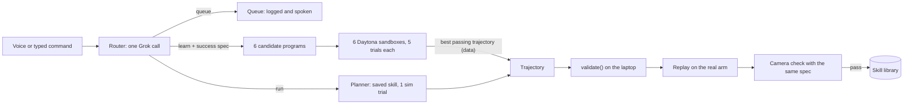

# Contracts

Every lane codes against these contracts, and `schemas/*.json` and `tests/contract/` are their machine-checked copies. Change one only after the team agrees, then update prose, schema and test together.



Every request takes one of three paths. Saved skills are re-planned in simulation and replayed. New tasks get a success test first, then six programs scored in parallel sandboxes, and only the winner's checked path reaches the arm. Tasks we can't check are queued.

**Request flow.**

1. Voice (the Grok Voice Agent's `do_task` tool) or the typed box sends `POST /command`.
2. The router, one Grok call, returns `run`, `learn` (with a task spec), `define_routine`, `queue` or `stop`.
3. `run`: the planner runs the saved skill once in simulation on the current scene and records its trajectory.
4. `learn`: six candidate programs run five trials each in six Daytona sandboxes, all scored by the same task spec. The best passing candidate's trial-1 trajectory is kept.
5. The laptop validates the trajectory, the arm replays it, and the camera checks the same task spec. A passing `learn` is saved to the library.
6. `queue`: logged and spoken; nothing moves.

**Coordinate frame and units.** The origin is on the table directly below the shoulder_pan axis. +x points straight out from the arm when shoulder_pan is 0, +y to the arm's left, +z up; the table is z = 0. Our code uses meters, radians and seconds; degrees exist only inside `arm/driver.py`. Joint vectors are `[shoulder_pan, shoulder_lift, elbow_flex, wrist_flex, wrist_roll]`. The gripper is separate: 0.0 closed to 1.0 open in our code, 0 to 100 inside LeRobot.

**Scene state** (`schemas/scene.json`). Lane B publishes it at 10 Hz; in simulation, candidates read it through `robot.scene()`.

```json
{
  "t": 1792209600.12,
  "objects": {
    "pill_bottle": {"marker": 10, "x": 0.18, "y": -0.12, "yaw": 0.0, "h": 0.07, "size": [0.035, 0.035], "seen": true},
    "juice_box": {"marker": 11, "x": 0.24, "y": -0.04, "yaw": 0.3, "h": 0.105, "size": [0.063, 0.04], "seen": true},
    "tea_tin": {"marker": 12, "x": 0.15, "y": 0.03, "yaw": 0.0, "h": 0.09, "size": [0.04, 0.04], "seen": true}
  },
  "obstacles": {
    "cereal_box": {"marker": 30, "x": 0.24, "y": 0.11, "yaw": 0.0, "h": 0.2, "size": [0.19, 0.06], "seen": true}
  },
  "hand": {"marker": 40, "x": 0.30, "y": 0.02, "z": 0.03, "seen": false},
  "zones": {
    "tray": {"x": 0.30, "y": 0.22, "r": 0.07, "wall": 0.035, "slots": [[0.28, 0.20], [0.32, 0.20], [0.28, 0.24], [0.32, 0.24]]},
    "handoff": {"x": 0.30, "y": 0.00, "z": 0.10}
  }
}
```

x and y are the center on the table, `yaw` is in radians, and `h` and `size` come from `config/objects.yaml`. `size` is the footprint `[length along yaw, width across]`; the gripper closes across the width. `seen` turns false after 0.5 s without a detection, keeping the last pose. Obstacles are never moved by any skill. The hand's z is the fixed wristband height, 0.03.

**Task spec** (`schemas/task_spec.json`). The router writes it before any candidate exists. The dashboard shows it, every simulated trial is scored with it, and the camera check after the real run uses it again.

```json
{
  "name": "clear_table",
  "description": "Put every object on the table into the tray.",
  "params": {},
  "success": {"all": [{"in_zone": {"object": "*", "zone": "tray"}}]},
  "english": "Every object ends inside the tray."
}
```

| Predicate | Example | True when |
| --- | --- | --- |
| `in_zone` | `{"in_zone": {"object": "juice_box", "zone": "tray"}}` | The object's center is within the zone radius in `after` |
| `near` | `{"near": {"object": "tea_tin", "x": 0.2, "y": 0.0, "tol": 0.03}}` | The object's center is within `tol` of (x, y) in `after` |
| `moved` | `{"moved": {"object": "$object", "min": 0.05}}` | The object moved at least `min`, or is no longer seen (the user took it) |
| `not_moved` | `{"not_moved": {"object": "tea_tin", "max": 0.02}}` | Seen in both snapshots and moved at most `max` |
| `event` | `{"event": "handoff_done"}` | The run's event log contains that event |
| `all`, `any`, `not` | `{"all": [...]}` | Combine predicates |

- `"*"` means every object seen in `before`, never obstacles. `"$name"` is replaced by `args["name"]`. `params` maps each argument name to `"object"`, `"zone"` or `"number"`.
- If `in_zone`, `near` or `not_moved` names an object that is unseen in `after`, that predicate is false.
- The evaluate function also requires, implicitly, every obstacle `not_moved` with `max` 0.02.
- A spec that is already true on `before` is rejected ("That already looks done"). A task whose success can't be written with these predicates is queued.
- `sim/success.py` exports `evaluate(spec, before, after, args, events) -> bool`. It runs in sandboxes and on the laptop, and it is our code, never AI-written.

**Robot API, simulation only.** `SimRobot` in `arm/sim_robot.py` implements it, and AI-written code sees nothing else. None of it exists on the real arm, which only replays the trajectory this API records.

```python
class Robot:
    def scene(self) -> dict: ...                 # current scene, schemas/scene.json
    # Tip to (x, y, z) in meters. pitch: jaw axis from horizontal in radians, -pi/2 = straight down.
    # speed in m/s, capped at 0.2. Returns False if unreachable or outside the workspace.
    def move_to(self, x, y, z, pitch=-math.pi/2, speed=0.15) -> bool: ...
    def set_roll(self, angle) -> None: ...       # gripper rotation about its own axis, radians
    def open_gripper(self) -> None: ...
    def close_gripper(self) -> bool: ...         # True if an object is now held
    def home(self) -> None: ...                  # tucked pose that hides no marker from the camera
    # Helpers. transit_z: if given, rise to that height before any sideways move and travel at it.
    def pick(self, name, approach=0.08, transit_z=None) -> bool: ...
    def place(self, x, y, release_z=0.05, approach=0.08, transit_z=None) -> bool: ...
    def place_in_zone(self, zone, slot=None, transit_z=None) -> bool: ...  # slot None = next free slot
    def carry_to_hand(self) -> bool: ...         # a live primitive on the real arm (see Trajectory)
    def run_skill(self, name, args) -> bool: ... # runs a saved skill; used by routines
```

- Without `transit_z`, a move to a new spot is one joint-space sweep from the current pose, which can pass low over obstacles. That default is deliberate: candidates that notice the obstacle and set `transit_z` score better (Demo script).
- `pick` descends to `max(h/2, 0.02)` with the jaws across the object's width. The sim attaches the object only if the tip is within 1.0 cm of its center line, between 20% and 80% of its height, and within 20° of its yaw; otherwise `close_gripper` returns False.
- `place_in_zone` releases at the zone's wall height plus half the held object's height plus 0.01 m.
- `carry_to_hand` in sim moves above the hand (or the `handoff` zone if the hand isn't seen), opens, backs off 5 cm, goes home, logs `handoff_done`, and records a `live` segment.
- `SimRobot` counts collisions (any contact by the robot or held object except with the object being gripped, including the user's hand box when the hand is seen), joint-limit hits (within 1° of a limit) and IK failures. A trial ends in an error after 60 s of simulated time.

**Candidate program.** The code-writing model returns exactly one file:

```python
import math

def run(robot, args):
    scene = robot.scene()
    objs = scene["objects"]
    tallest = max([o["h"] for o in scene["obstacles"].values()] + [0.0])
    for name in sorted(objs, key=lambda n: objs[n]["x"]):
        if not robot.pick(name, transit_z=tallest + 0.08):
            return False
        if not robot.place_in_zone("tray", transit_z=tallest + 0.08):
            return False
    robot.home()
    return True
```

`agents/candidates.py` exports `check_source(src, entry="run") -> list[str]`; an empty list means accepted. It rejects a file that:

- imports anything but `math`, or has top-level statements other than a docstring, imports, function definitions and assignments of literal values;
- lacks its entry function, by default a top-level `run(robot, args)`;
- uses `open`, `exec`, `eval`, `compile`, `__import__`, `getattr`, `setattr`, `delattr`, `globals`, `locals`, `vars`, `input`, `breakpoint`, `help`, `dir`, `type`, `object` or `super`;
- uses any name or attribute starting with `_`;
- contains `class`, `global`, `nonlocal`, `async`, `await`, `yield` or `with`;
- has a bare `except:` or catches `BaseException` (the sim's time limit is a `BaseException`);
- is longer than 200 lines.

The orchestrator runs the check before scoring and asks the model again once on rejection; `sim.run_candidate` runs it again inside the sandbox.

**Trajectory** (`schemas/trajectory.json`). This is what a sandbox hands back: data, never code. `SimRobot` records it during trial 1, the scene as observed.

```json
{
  "version": 1,
  "skill": "clear_table",
  "args": {},
  "dt": 0.0333,
  "joints": ["shoulder_pan", "shoulder_lift", "elbow_flex", "wrist_flex", "wrist_roll"],
  "segments": [
    {"kind": "path", "q": [[0.0, -1.75, 1.6, 0.75, 0.0], [0.006, -1.741, 1.593, 0.748, 0.0]]},
    {"kind": "grip", "action": "close", "object": "juice_box", "expect_held": true},
    {"kind": "path", "q": [[0.006, -1.741, 1.593, 0.748, 0.0]]},
    {"kind": "grip", "action": "open", "object": "juice_box"},
    {"kind": "live", "primitive": "carry_to_hand", "object": "pill_bottle"}
  ]
}
```

Lane A's `arm/replay.py` owns these rules:

- `validate(traj, limits, fk, box) -> list[str]` returns every problem; an empty list means accepted. Here fk(q) returns the tip's (x, y, z), limits maps each joint name to its [low, high] in radians, and box is the workspace from config/scene.yaml. It checks the schema, every waypoint within the joint limits minus 3°, every step between consecutive waypoints at most 2° per joint (60°/s at 30 Hz), every waypoint's tip from `fk` inside the workspace box, and `live` primitives in the allowlist `carry_to_hand`, `home`.
- `replay(traj)` streams waypoints at 30 Hz. Before each `path` segment, if the arm is more than 1° from the first waypoint, it bridges there with a validated joint-space move at 30°/s at most.
- A `grip` close waits 0.4 s and reads the gripper. If holding doesn't match `expect_held`, replay aborts: rise 5 cm, go home, return `grasp_missed`.
- A `live` segment calls our primitive in `arm/real_robot.py`. `carry_to_hand` ends at home, and the next segment bridges from there.
- Every tick checks the STOP flag and the hand. Outside `carry_to_hand`, a wristband seen within 10 cm of the tip freezes the arm until `/resume`.
- `replay` returns `{"ok": bool, "reason": null | "grasp_missed" | "stopped" | "hand_too_close" | "error", "events": [...]}`.

**Scoring** (`sim/scoring.py`, run by `sim.run_candidate` inside each sandbox).

- Trial 1 uses the scene as observed and records the trajectory. Trials 2 to 5 shift every object by up to ±1 cm and ±10° of yaw (obstacles ±0.5 cm), seeded so every candidate faces the same five scenes.
- Each trial records success from the task spec, collisions, limit hits, IK failures, simulated seconds and any error.
- A candidate **passes** when trial 1 succeeds, at least 4 of 5 trials succeed, and all five have zero collisions, zero limit hits and no errors.
- Passing candidates rank by successes, then by mean simulated seconds (lower first).
- Outputs: `out/traj.json`, `out/final_scene.json` (trial 1's end state) and one JSON line on stdout (`schemas/score.json`).

```json
{"candidate": 3, "passed": true, "successes": 5, "trials": 5, "nominal_success": true, "collisions": 0, "limit_hits": 0, "ik_failures": 0, "mean_sim_s": 21.4, "fail_reason": null, "traj": "out/traj.json", "error": null}
```

`fail_reason` is one short phrase for the dashboard card, such as "trial 3: gripper hit cereal_box".

**Skill library** (`schemas/skill.json`). One file per skill, `skills/<name>.json`:

```json
{
  "name": "clear_table",
  "trusted": false,
  "spec": {"name": "clear_table", "description": "Put every object on the table into the tray.", "params": {}, "success": {"all": [{"in_zone": {"object": "*", "zone": "tray"}}]}, "english": "Every object ends inside the tray."},
  "code": "<full candidate source>",
  "sim": {"successes": 5, "trials": 5},
  "real": {"runs": 1, "successes": 1},
  "created": "2026-10-17T14:02:00-04:00"
}
```

`trusted: true` marks the two hand-written starter skills in `skills/_starter/`; only those may be planned in a local subprocess while Daytona is reachable. `POST /reset_demo` restores the library to exactly those two. The RL policy is not a skill: it is how `carry_to_hand` moves once M4 passes (`config/rl.yaml`, `use_policy: true`).

**Router output** (`schemas/router.json`). `agents/router.py` gets the request text, each skill's name, description and params, and the scene's object, obstacle and zone names. It returns exactly one of:

```json
{"action": "run", "skill": "hand_over", "args": {"object": "pill_bottle"}}
{"action": "learn", "spec": {"name": "clear_table", "description": "Put every object on the table into the tray.", "params": {}, "success": {"all": [{"in_zone": {"object": "*", "zone": "tray"}}]}, "english": "Every object ends inside the tray."}}
{"action": "define_routine", "name": "good_morning", "steps": [{"skill": "hand_over", "args": {"object": "pill_bottle"}}, {"skill": "hand_over", "args": {"object": "juice_box"}}]}
{"action": "queue", "task": "Fold my laundry", "reason": "needs cloth handling"}
{"action": "stop"}
```

`learn` covers moving known objects between known places when success fits the predicates. Everything else (cloth, liquids, unknown objects, motion toward a person beyond the hand-off spot) is `queue`. A `learn` with no passing candidate also ends as `queue`.

**Orchestrator API** (`agents/orchestrator.py`, FastAPI on `localhost:8000`, one task at a time).

| Endpoint | Input | Result |
| --- | --- | --- |
| `POST /command` | `{"text": "..."}` | `{"task_id": "t-0042"}`, or HTTP 409 while busy |
| `POST /stop` | none | Freeze in place with torque on, cancel the task, state `stopped` until `/resume` |
| `POST /resume` | none | Leave `stopped`; the arm goes home at 30°/s at most |
| `POST /torque_off` | none | Maintenance only; refused while a task runs |
| `POST /calibrate` | none | Re-runs the table calibration check and returns the error in cm |
| `POST /reset_demo` | none | Archive learned skills to `runs/archive/`, restore the two starter skills, clear the queue and routines |
| `POST /load_backup` | none | Copy `skills/_backup/*.json`, skills learned in rehearsal, into the library |
| `POST /voice/token` | none | Short-lived xAI token for the voice page |
| `GET /state` | none | `{"state", "mode", "skills", "queue", "carry"}`, where `carry` is `"rl"` or `"ik"` |
| `WS /events` | none | Stream of events (`schemas/event.json`) |

An event looks like `{"t": 1792209641.2, "task_id": "t-0042", "stage": "candidate_scored", "detail": {...}}`. Stages: `routing`, `spec_ready`, `writing_code`, `candidate_rejected`, `simulating`, `candidate_scored`, `selected`, `planning`, `validating`, `executing`, `verifying`, `saved`, `not_saved`, `queued`, `done`, `stopped`, `error`.

| Budget | Normal | `DEMO_MODE=1` (judging) |
| --- | --- | --- |
| Routing and spec | 15 s | 10 s |
| Code writing | 45 s | 30 s; proceed with 3 or more valid candidates |
| Simulation | 90 s | 35 s; unfinished candidates fail as "timeout" |
| Repair round | On | Off |
| Command to arm moving | No cap | 75 s hard cap, else `queued` |
| Real execution | 90 s | 90 s |

A timeout ends the task as `error` (or `queued` while learning), and the arm goes home.

**Voice tools.** Declared in the Grok Voice Agent's `session.update`:

| Tool | Arguments | What it does |
| --- | --- | --- |
| `do_task` | `text`: the user's words | Calls `POST /command` and answers "On it" at once; when `/events` reports the end stage, speaks the result ("Done. Saved clear table.") |
| `stop` | none | Calls `POST /stop` |
| `list_skills` | none | Returns skill names to read aloud |

Voice instructions: "You are the voice of a home robot arm. For any physical request, call do_task with the user's exact words. If the user says stop, call stop immediately. If do_task reports busy, say 'One moment.' Keep spoken replies under 12 words."

**Fakes.** `FAKE=1` sets all four; each also works alone.

| Flag | Stands in for | Behavior |
| --- | --- | --- |
| `FAKE_LLM` | xAI | Router replies, specs and candidates come from `tests/fixtures/llm/`, keyed by phrase; unknown phrases route to `queue` |
| `FAKE_SANDBOX` | Daytona | Runs the same `sim.run_candidate` command as a local subprocess, which is also the live fallback |
| `FAKE_ROBOT` | Arm | In-memory joints that follow commands instantly; grip checks return `expect_held` |
| `FAKE_CAMERA` | Cameras | Scene from `config/fake_scene.json`; the after-snapshot is the sandbox's `final_scene.json` |

Until A8 lands, `arm/sim_robot.py` is a kinematic stand-in (objects move with the gripper, no physics), so the pipeline runs end to end from the scaffold on.
